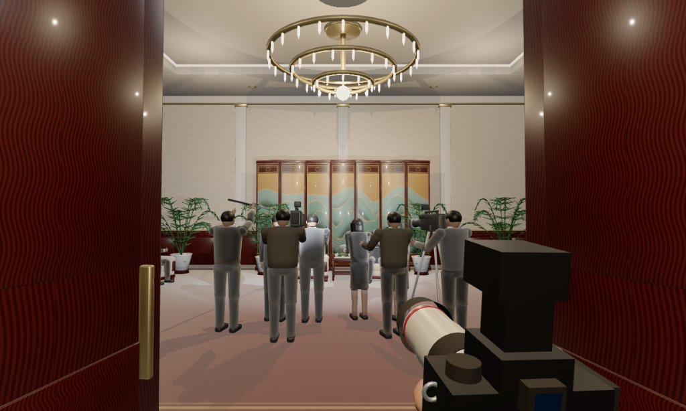

# 记者模拟器 · Journalist Simulator



千禧之交的一个秋日下午，暖黄吊灯落在暗红羊毛地毯上。  
磁带在肩扛摄像机里微微转动，闪光灯电容发出低不可闻的充能声。

你站在人群边缘，胸前挂着一台沉甸甸的单反。  
走近，或是退后；找一张空着的扶手椅坐下，或是在人群后静静蹲身。  
举起相机，把眼睛凑上取景器，拨动焦环与光圈，在反光板弹起的那一瞬按下快门，去记录，去旁观，去见证那段留在银盐颗粒里的现场。

*Raise the viewfinder to your eye. Turn the aperture ring, listen for the shutter, and witness a fleeting afternoon at the turn of the millennium.*

→ [推门入场 · ghsaimo.github.io/journalist-simulator](https://ghsaimo.github.io/journalist-simulator/)

---

```bash
npm install
npm run dev
# http://127.0.0.1:1926
```

`WASD` 走动 · `右键` 凑近取景 · `滚轮` 变焦 · `Q / E` 光圈 · `左键` 快门 · `C` 蹲身 / 落座 · `G` 相册
